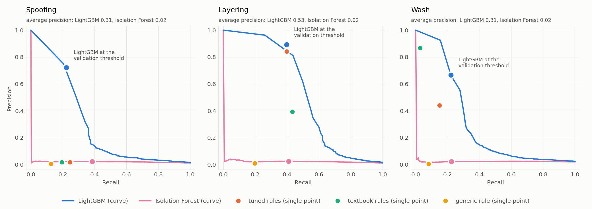
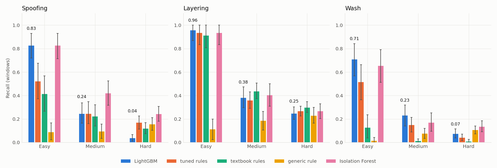
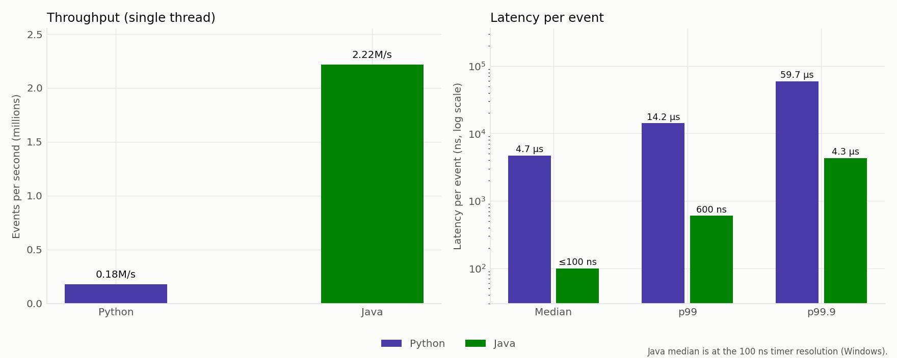

# Sentinel: trade surveillance for spoofing, layering and wash trading

Sentinel is a small end-to-end surveillance system built on **synthetic** market data: an order-book simulator that injects labeled manipulation, a streaming feature extractor, a rules baseline, a gradient-boosted classifier with SHAP explanations, and a Java engine that runs the whole detection loop one event at a time. It was built to practise the work of a compliance-engineering team: find abuse in trading data, measure how well, and explain each alert to an investigator.

**New here?** Download [docs/sentinel-demo.html](docs/sentinel-demo.html) and open it in a browser (GitHub shows HTML files as source code, so it will not run inside the repository page): an interactive replay of real simulated trading where you can watch the order book, try to spot the manipulation, and see what Sentinel decided and why.

The interesting part is not a big number. It is that the evaluation is set up so the numbers can be trusted, and that the results, including the unflattering ones, are reported as they came out.

## ARGUS presentation

Open [argus-presentation.html](argus-presentation.html) in a browser for the combined presentation. Scroll down through the 3D market, order book, AI model diagram, and reference-study performance metrics.

The merged presentation embeds all four screens in one HTML file.

## SD-FMM reference implementation

The upstream [SD-FMM project](https://github.com/ys-Dai/SD-FMM) is included as a Git submodule in [`vendor/SD-FMM`](vendor/SD-FMM), pinned to commit `0d1a2158ee849fdc31a127bd049e622174f5c893`. Its original source and MIT license are preserved.

After cloning this repository, fetch the submodule with:

```bash
git submodule update --init --recursive
```

See its [README](vendor/SD-FMM/README.md) for setup and training instructions. This is a reference implementation; it is not yet connected to the ARGUS application or presentation.

## Results at a glance

Measured on a simulation created after every modelling decision was frozen (1.6M events, 24,664 ten-second trader-windows, 1,067 manipulation windows from 377 injected episodes; 389 were injected, and the 12 that left no labeled window, 9 of them easy wash trades, are not counted). All alerts come from the **Java engine**. Full tables with 95% confidence intervals: [RESULTS.md](RESULTS.md).

| Detector | Precision | Recall | F1 | False-positive rate |
|---|---|---|---|---|
| Generic rule (cancel rate ≥ 90% or order-to-trade ≥ 50) | 0.02 | 0.13 | 0.03 | 28.2% |
| Tuned rules (thresholds optimised on validation data) | 0.08 | 0.33 | 0.13 | 16.3% |
| **LightGBM** | **0.77** | 0.29 | **0.42** | **0.4%** |

(Any manipulation type versus normal trading. Per-type breakdown below.)



What these numbers do and do not say:

- **The model's advantage is precision, not extra catches.** At similar recall it raised 92 false alerts where the tuned rules raised 3,838 (about 40 times fewer; 63 versus 2,610 false alerts per instrument-hour of simulated trading). The tuned rules' overall recall is in fact slightly higher (paired difference −0.04, interval excludes zero).
- **Per type**, F1 is spoofing 0.34 (rules 0.04), layering 0.55 (rules 0.54), wash 0.33 (rules 0.22). For **layering, the model and the tuned rules are statistically indistinguishable**: layering is a simple pattern and rules find it. The model clearly wins on spoofing and wash trading, where the signal is a combination of behaviours.
- **Hard cases are mostly missed by design.** Recall on the hardest difficulty level is 4% (spoofing), 25% (layering) and 7% (wash), against 83%, 96% and 71% on the easiest. The hard scenarios are built to look like ordinary trading, so this is the point of the difficulty dial, not a surprise.
- **Two-thirds of cases were noticed at least once.** At least one window was flagged in 67% of injected episodes overall (95% interval 62% to 71%), so the analyst-relevant question "did we notice this case at all" has a better answer than window-level recall.
- **Unsupervised anomaly detection was not useful here.** An Isolation Forest flags 21% of innocent windows, because market makers legitimately behave like outliers. Its higher recall on hard cases comes from flagging so much; the precision-recall chart is the fair comparison.



## The three manipulation types, in plain language

A limit order book lists the prices at which people have offered to buy (bids) and sell (asks). Traders can submit orders, cancel them, or change them; when a buy meets a sell, they trade. Manipulation exploits the fact that other participants read the book as a signal of supply and demand.

- **Spoofing.** Place a large order you do not intend to fill on one side of the book, for example a big bid that suggests strong demand. Other participants react and the price moves toward you. You then trade the *other* side at a better price and cancel the large order before it executes.
- **Layering.** Spoofing spread across several price levels: a stack of orders at successive prices makes the pressure look deeper and more credible, and the stack is cancelled together.
- **Wash trading.** Two accounts controlled by the same party trade with each other, creating volume and the appearance of interest with no real change in position.

In the simulator these are injected as scripted scenarios that run through the same matching engine as normal flow, each at three difficulty levels (easy, medium, hard) controlling how large the fake orders are relative to the book, how long they rest, how much ordinary-looking activity is mixed in, and how much wash trades are jittered.

## How the system works

```
  order-book simulator            streaming engine (Python reference, Java port)
  (matching engine, agents,   ->  event -> per-trader window features -> rules / LightGBM
   injected manipulation)         (one event at a time; a 10 s window closes -> score)
            |                                   |
     labeled event log                      alerts + SHAP explanation
            |                                   |
            +---------- evaluation (bootstrap CIs, PR curves, RESULTS.md) ----------+
```

**1. Simulator** ([src/sentinel/sim](src/sentinel/sim)). A price-time-priority limit order book with real matching, and four instruments of agent-based flow: market makers that quote both sides and cancel almost everything legitimately, noise traders whose behaviour leans with book imbalance, and momentum traders. Manipulators are borrowed noise traders, so their windows contain both ordinary and manipulative activity. Prices and times are integers, and labels are kept out of the event log so a detector cannot read them by accident. The causal claim that spoofing moves the price is tested: mid-price moves about +0.4 ticks in the intended direction (13 standard errors; a typical spread is 1 to 2 ticks).

**2. Features** ([src/sentinel/features](src/sentinel/features)). One streaming extractor, used for training, for the Python engine and as the reference for the Java port. For every trader in every 10-second window it emits 22 numbers: cancel rates and how quickly orders are cancelled, order size relative to the book, the number of price levels held at once, bursts of cancels, the share of executions on the side opposite to the trader's largest resting orders, and counterparty concentration and round-trips for wash trading. No identifiers, timestamps or instrument names are features.

**3. Detectors** ([src/sentinel/detect](src/sentinel/detect)).
- *Rules baseline.* Three typed rules plus the classic generic screen. The textbook thresholds were fixed from the standard definitions and committed under the tag `rules-preregistered` before any rule was evaluated. A tuned variant optimises thresholds on validation data, starting from the textbook values, so it is never worse than them there.
- *Model.* One LightGBM multiclass model (normal, spoofing, layering, wash) with small trees and per-type alert thresholds chosen on validation data.
- *Unsupervised comparator.* An Isolation Forest.
- *Explanations.* Every model alert carries SHAP contributions, rendered as plain sentences next to what a typical normal window looks like. Rule alerts show which conditions fired. For example (validation data):

```
ALERT LAYERING  trader 48  SYM0  window 95  score 0.74  (model)
  - max_live_levels_same_side: held orders at 5 price levels on one side at once (typical 4, SHAP +1.04)
  - max_cancel_burst_100ms: cancelled 8 order(s) within 100 ms (typical 1, SHAP +0.95)
  - n_new: sent 14 new order(s) (typical 12, SHAP +0.37)
```

  SHAP explains the *model*, not the ground truth, and that is visible in a wash-trading alert from the same report: its second-strongest reason is "largest order was 1.0x the quantity at the best price", which is a leftover simulator artifact (see limitations), not something an investigator would recognise as wash trading.

**4. Streaming engine** ([java/](java), [src/sentinel/stream](src/sentinel/stream)). The Python engine is the reference. The Java engine is a line-by-line port with no dependencies (plain `javac`): the feature extractor, the rules, and a parser and evaluator for LightGBM's text model format. SHAP stays in Python and runs only on alerts, off the per-event path.

- **Parity.** On a full 1.6M-event stream the two engines produce identical feature rows (bit-identical values), class probabilities and alert sets (24,649 rows, 15,180 alerts across the four detectors). A second test checks the Java tree evaluator against Python on 200 fixed cases.
- **Speed.** Single-threaded, per-event timing including scoring, on a Windows 11 machine with 16 logical cores (details in [RESULTS.md](RESULTS.md)):

| Engine | Events per second | Median time per event | p99 | p99.9 |
|---|---|---|---|---|
| Python (reference) | 179,000 | 4.7 µs | 14.2 µs | 59.7 µs |
| Java | 2,218,000 | ≤ 100 ns | 600 ns | 4.3 µs |

  Java's median is at the 100 ns resolution of the Windows timer, so read it as an upper bound. These are processing times per event inside the engine, not the delay before an alert reaches an analyst: an alert for a window appears when that window closes (up to 10 seconds after the behaviour) plus the scoring time shown for window-closing events. Throughput and median agree: 2.2 million events per second is a mean of about 0.45 µs per event, above the 0.1 µs median, because the 164 window-closing events (about 1 ms each) account for roughly two thirds of the total processing time. The tail is dominated by the few events (about one in 3,000) that close a window and score every active trader: about 1 ms in Java. One profile-guided change (flattening the trees into contiguous arrays after a flight-recorder profile showed tree evaluation at 60% of CPU time) improved throughput by about 12%; parity was re-verified after it.



## Methodology, and what was done to keep the numbers honest

- **Leak-free split.** Training and validation come from three simulations split by time, with any manipulation episode that straddles the boundary (or falls in the two boundary windows) dropped from both sides.
- **A test set that did not exist during modelling.** The final evaluation uses a fourth, freshly generated simulation. Before it was first loaded, the model, thresholds, rules, feature extractor and Java sources were hashed and committed (tag `stage4-frozen`, [docs/frozen-artifacts.json](docs/frozen-artifacts.json)); the evaluation code refuses to run if any hash changed, and the loader logs every access to the test data. It was loaded once. The evaluation pipeline was debugged beforehand on a separate rehearsal simulation.
- **Confidence intervals that respect the data's structure.** Windows of one manipulation episode are near-copies, and an account's innocent windows resemble each other, so intervals come from a cluster bootstrap that resamples whole episodes and whole accounts, and comparisons between detectors are paired on the same resamples. The bootstrap is tested on synthetic populations with known answers, including that its intervals cover the true value at about the nominal rate.
- **Independent review of the data before trusting it.** A review of the simulator before any model existed found and fixed several ways a detector could cheat (for example, only wash trades produced orders that filled instantly, and fake orders were orders of magnitude larger than anything normal). One more artifact surfaced after the first model was trained, when a SHAP explanation looked wrong. It was fixed and all data regenerated, and the change is disclosed, including that it was motivated by detector output, in [docs/data-design-log.md](docs/data-design-log.md).

## Limitations

Read these before drawing any conclusion about real markets.

- **The data is synthetic, and measurably unlike a real market.** Agents follow simple stochastic rules (Poisson arrivals, lognormal sizes, quotes centred on the mid). Real markets have hidden and iceberg orders, auctions, fees, latency, queue-position strategies, many venues and cross-instrument behaviour, none of which are modelled. Compared with one day of real AAPL data from NASDAQ's LOBSTER sample ([docs/lobster_comparison.md](docs/lobster_comparison.md)): the cancel-to-new ratio is close (0.94 simulated, 0.85 real), but the real spread is about 15 ticks against 1, the simulated book is 4 to 6 times deeper relative to order size, real orders cluster on round lots of 100, and real arrivals are far burstier (95th-percentile gap about 290 times the median, against 3 in the simulator). The simulator was not tuned to close these gaps, and detector performance here should not be assumed to transfer. LOBSTER's free samples carry no trader identifiers, so they can validate market statistics but could never supply labeled manipulation.
- **Prevalence is far too high.** About 4% of windows here contain manipulation; in real markets it is orders of magnitude rarer. Precision depends on prevalence: with the same recall (0.29) and false-positive rate (0.39%), a prevalence 100 times lower would give a precision of roughly 3%, not 77%. The false-positive rate, not the precision figure, is what to carry over.
- **Manipulation is defined by construction.** Labels come from the scenarios that were injected, so "detected" means "found what was injected". The three scenarios are simple archetypes, and a real spoofer adapts to the surveillance it faces.
- **Only noise traders act as manipulators.** Market-maker and momentum accounts are never positives, so trader type would be a proxy for the label; that is why no identifier is used as a feature.
- **A residual wash-trading artifact.** Wash orders still tend to rest alone at the best price more often than normal orders do (about 16% of wash windows versus 3% of normal ones, after the fix; 34% versus 0.3% before). It cannot be fully removed in a market whose spread is usually one tick.
- **Spoofing's price impact is modest** (about +0.4 ticks), because it works through simulated agents that lean with book imbalance.
- **Some choices were made on validation data.** Rule tuning, alert thresholds and early stopping used the validation split, so validation scores are optimistic (validation any-type F1 0.45 versus 0.42 on the test set). The test intervals reflect sampling of episodes and accounts within this simulator, not the chance that the simulator itself is wrong.
- **Explanations are model explanations.** SHAP shows what pushed the model's score, which is not always what a human would call the reason (see the wash example above).
- **Benchmark scope.** One machine, one thread, the first 500,000 events of a training-set stream, per-event timing that includes the cost of the timer, which is subtracted only where the timer can resolve it (Python: 100 ns; for Java it measured as 0 because the Windows timer ticks in 100 ns steps). That resolution limits how small a median can be claimed. Max latencies are single worst events and vary run to run.
- **Detection delay is built in.** A window's features exist only when it closes, so an alert arrives up to 10 seconds after the behaviour.

## Reproducing everything

Requires Python 3.11+ and a JDK (`javac` and `java` on the path). Data, models and artifacts are not committed.

On macOS with Homebrew, install the Java tools and the OpenMP runtime used by LightGBM:

```bash
brew install libomp openjdk
export PATH="$(brew --prefix openjdk)/bin:$PATH"
```

Create and activate a Python 3.11+ virtual environment before installing the project.

```bash
python -m pip install -e ".[dev]"
python -m pytest                                    # 143 tests, including Java parity tests

for s in 7 8 9; do python scripts/generate_data.py --out data/sim_seed$s --seed $s; done
python scripts/train_detectors.py                   # trains everything, writes the validation report
python scripts/parity_check.py                      # Python vs Java on a full simulation
python scripts/bench_stream.py --n 500000           # throughput and latency of both engines

python scripts/generate_data.py --out data/test_seed100 --seed 100
python scripts/freeze_artifacts.py                  # then commit the manifest and tag it
python scripts/final_evaluation.py --sim data/test_seed100 --final --charts-dir docs/img --results RESULTS.md
```

Everything is seeded and deterministic. The freeze check compares hashes of the trained model files, so on a different machine you would re-freeze after retraining.

## Repository layout

```
src/sentinel/sim/        order book, agents, injected scenarios, labels, LOBSTER comparison
src/sentinel/features/   streaming feature extractor
src/sentinel/detect/     rules, LightGBM and Isolation Forest, SHAP explanations, alerts, splits
src/sentinel/stream/     Python engine, export formats, benchmark, Java runner, parity check
src/sentinel/eval/       metrics, cluster bootstrap, PR curves, freeze check, charts, RESULTS.md generator
java/src/sentinel/       the Java engine (about 1,000 lines, no dependencies)
scripts/                 command-line entry points
tests/                   143 tests
docs/                    design log, frozen-artifact hashes, benchmark data, figures
docs/superpowers/        the design specs and implementation plans each stage was built from
```

Design specs and plans for each stage are in [docs/superpowers](docs/superpowers).

## ARGUS local surveillance MVP

ARGUS wraps the Sentinel exchange in a live, controllable ten-agent demo and adds a React surveillance console, a synchronized-behavior graph, evidence-backed investigations, human-reviewed restrictions, and an SQLite audit trail.

Install the API extras and frontend packages:

```bash
python -m pip install -e ".[argus]"
cd frontend && npm install
```

Run the API and UI in separate terminals:

```bash
uvicorn argus.api:app --app-dir src --host 127.0.0.1 --port 8000
```

```bash
cd frontend && npm run dev
```

Open the local Vite address shown in the frontend terminal, then select **Start demo**. The seeded run includes ten agents; three repeatedly place and cancel orders in close succession. ARGUS detects repeated cross-agent patterns from observed events, opens a case, and proposes a temporary restriction. The exchange applies it only after an analyst approves. Reset starts a clean run; use the same seed to reproduce the behavior.

Sentinel's rules run immediately. To enable its LightGBM scores and SHAP explanations, generate training simulations and train the included model as described under [Reproducing everything](#reproducing-everything). The training step also saves normal-feature reference values used by the investigator. Without `ARGUS_LLM_API_KEY`, ARGUS displays a deterministic evidence-based investigation brief. To enable an OpenAI-compatible investigator, set `ARGUS_LLM_API_KEY`, and optionally `ARGUS_LLM_BASE_URL` and `ARGUS_LLM_MODEL`; investigations contain synthetic demo evidence only.

The demo uses SQLite at `data/argus.sqlite3` by default. Set `ARGUS_DB_PATH` to use another local database file.
